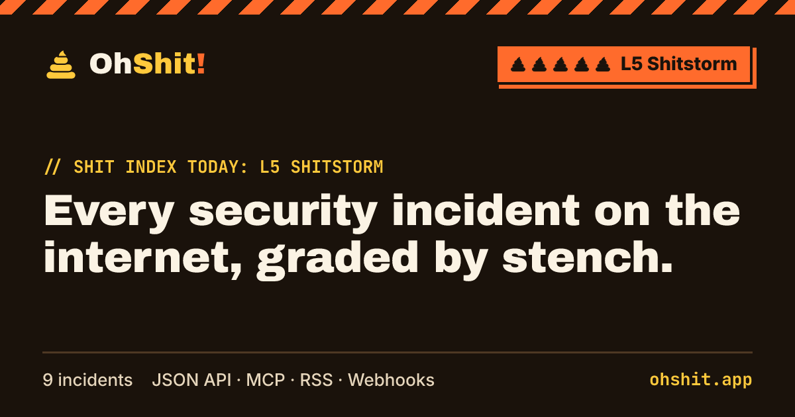

[](https://ohshit.app)

# [OhShit!](https://ohshit.app)

**Every security incident on the internet, graded by stench**, each with a plain-language clean-up guide.

- **5 levels**, from L1 Silent Fart to L5 Shitstorm, so you know at a glance whether to drop everything
- **One page per incident**: what happened, CVEs, an "am I affected?" version checker, mitigations, a timeline,
  **who said what** (sources, including where they disagree) and a clean-up checklist
- **Open data**: every incident is a Markdown file in this repo, served as static JSON, RSS and an MCP server

Live at **[ohshit.app](https://ohshit.app)**.

## Follow along

| Want | Use |
| --- | --- |
| New incidents in your reader, Slack or Discord | [`ohshit.app/rss.xml`](https://ohshit.app/rss.xml) (Slack: `/feed subscribe https://ohshit.app/rss.xml`) |
| Data for scripts and dashboards | [JSON API](#json-api) |
| Ask your AI agent "are we hit?" | [MCP server](#mcp-server) |

### JSON API

Static files, no key, no sign-up.

| Endpoint | Returns |
| --- | --- |
| [`/api/v1/incidents.json`](https://ohshit.app/api/v1/incidents.json) | All incidents, newest first, plus the current Shit Index |
| `/api/v1/incidents/{id}.json` | One incident, including timeline, sources and the Markdown body |
| [`/api/v1/smell-index.json`](https://ohshit.app/api/v1/smell-index.json) | Highest level in the last 7 days, and days since the last incident |

```bash
curl -s https://ohshit.app/api/v1/incidents.json | jq '.data[] | select(.level >= 4) | {id, title}'
```

The `v1` shape is stable. Breaking changes go to `/api/v2/`.

### MCP server

[`packages/mcp`](packages/mcp) is a stdio MCP server that reads the JSON API. It needs no key and keeps no state.

| Tool | Does |
| --- | --- |
| `list_incidents` | Recent incidents, filtered by `min_level`, `ecosystem`, `tag` or `days` |
| `get_incident` | Everything about one incident |
| `smell_index` | The current Shit Index |

Add it to your MCP client (Claude Desktop, Cursor, and others):

```json
{
  "mcpServers": {
    "ohshit": { "command": "npx", "args": ["-y", "@ohshit/mcp"] }
  }
}
```

Set `OHSHIT_API` to use a mirror instead of `https://ohshit.app/api/v1`.

## Contributing

Spotted an incident we missed, or something we got wrong? You don't need to touch any code.

- **Report it**: open a [new incident](https://github.com/becoolme/ohshit/issues/new?template=new-incident.yml) or
  [correction](https://github.com/becoolme/ohshit/issues/new?template=correction.yml) issue with a link to the source.
- **Write it up**: copy [`incidents/_template.md`](incidents/_template.md) to
  `incidents/<year>/<yyyy-mm-dd>-<slug>.md` and open a pull request.

```
incidents/
  _template.md                 ← copy this
  2026/
    2026-10-21-php2shell.md    ← becomes /incidents/php2shell/
```

Every file is validated against [`src/lib/incident-schema.ts`](src/lib/incident-schema.ts), so CI catches a typo before it
reaches the site. Read [CONTRIBUTING.md](CONTRIBUTING.md) for the sourcing rules and how to pick a level.

## Development

Requires Node.js 22.23 or later.

```bash
npm install
npm run dev      # http://localhost:4321
npm run build    # type-checks, validates every incident, renders share images, outputs dist/
```

Built with [Astro](https://astro.build). Pages, feeds and the CVE index are fully static. The CVE index at
`/cves/` and `/zh/cves/` searches the last 30 days using compressed index chunks in a browser Web Worker.
A daily GitHub Actions job syncs NVD and CISA KEV data and commits it to `main`. See
[CVE data, daily sync and local preview](docs/cve-index.md).

ohshit.app runs on Cloudflare Workers static assets ([`wrangler.jsonc`](wrangler.jsonc)). Cloudflare Workers
Builds deploys pushes to `main`; GitHub Actions validates the site and commits the daily CVE data,
which that push then deploys. The Shit Index is also a build-time
snapshot (`generated_at` records its freshness), so rebuild regularly to age out old incidents.

Run `npm test` for version, date-window, content-schema and configuration regression tests.
Run `npm ci && npm test` inside `packages/mcp` for the MCP protocol smoke tests.

```
src/
  content.config.ts   incident collection
  pages/              site, JSON API (api/v1), RSS, share images (og)
  components/         UI
  lib/                content schema, version checks, date metrics, share-image renderer
incidents/            the data
packages/mcp/         MCP server
```

### Analytics (optional)

Set both variables at build time to add a Plausible-compatible script to every page. Leave either unset and no
script is added. See [`.env.example`](.env.example).

```bash
PUBLIC_ANALYTICS_SRC=https://analytics.example.com/js/script.js PUBLIC_ANALYTICS_DOMAIN=example.com npm run build
```

## Disclaimer

OhShit! summarises public advisories and reports, and links every claim to its source. It can be wrong or out of
date. Always check the vendor's advisory before you act. Not affiliated with any vendor mentioned.

## License

[MIT](LICENSE), for both the code and the incident data.
